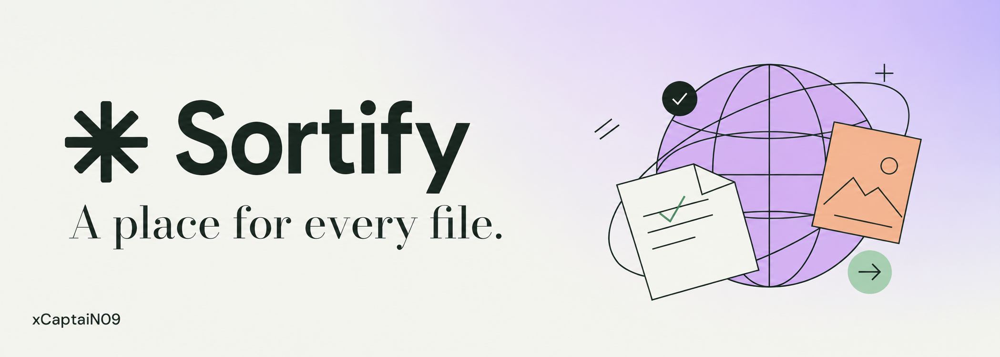

<p align="center"></p>

# Sortify

Offline download organization for rooted Android. Sortify moves eligible files
into categories, preserves naming conflicts, identifies duplicates by contents,
and records moves for Preview and Undo.

**Version 5.0** adds Preview, custom rules, content-based duplicate detection,
move history and Undo. Author: xCaptaiN09. MIT license.

[Download v5.0](https://github.com/xCaptaiN09/Sortify/releases/tag/v5.0) ·
[Changelog](CHANGELOG.md)

## Defaults

| Setting | Fresh installation |
| --- | --- |
| Automatic sorting | Off; enable it in Settings |
| Automatic interval | One hour |
| Keep recent downloads | One day; can be turned off |
| Source | `/sdcard/Download` |
| Destination | `/sdcard/Sortify` |
| Unknown files | Others; can be left in Downloads instead |
| History retention | 30 days, configurable from 1 to 365; latest 200 runs maximum |

Manual sorting works when automatic sorting is off. Sort Now and the module
manager's Action button both honor the delay, unfinished-download checks, ignore
rules, disabled categories and Undo protection. They start a run immediately;
they do not force every file to move.

Compatible settings are retained on upgrade. A v4 installation migrates its
existing interval and automatic sorting behavior. The new one-day delay starts
enabled; review it in Settings after upgrading. Existing organized files are
never rearranged as part of installation.

## Categories and rules

Documents, Images, Videos, Audio, Archives, Apps and Others are available by
default. Ebooks, Fonts, Subtitles, Code/config and Torrents are optional presets.
Advanced settings allow custom categories, extensions, destination folders,
filename/glob rules, priority ordering and ignore patterns.

- Custom rules are evaluated in visible order, followed by extension mappings.
- When rules overlap, Preview identifies the matching rules and winner.
- A disabled category leaves matching files in the source; it does not reroute
  them into Others or Duplicates.
- Unknown extensions use Others unless the user selects Leave in Downloads.
- Only files directly inside the source are scanned; subfolders are untouched.
- Destinations must be separate from the source and within the configured shared
  storage root. System/module/state paths and overlapping source/output trees
  are rejected. Changing a category does not move its previously organized files.

## Duplicates and file preservation

A filename match is not proof of a duplicate. Sortify first compares sizes, then
SHA-256 and bytes. An identical incoming copy goes to Duplicates; the organized
copy stays in place. Different contents sharing a name remain in the normal
category under an available name, such as `report (1).pdf`.

Every destination is created exclusively. Repeated collisions inside Duplicates
also receive available names. Sortify does not automatically delete duplicate
copies. Transfers are copied, verified and recorded before removing the source;
interrupted operations are reconciled from a persistent journal. Source capture
requires Linux renameat2 with RENAME_NOREPLACE; unsupported filesystems fail
without replacing another file. Android shared-storage directory modes are not
assumed to make staging folders private. Interrupted uncertain copies are
preserved and flagged for inspection rather than automatically deleted.

## Download handling

Hidden files and recognized temporary suffixes are skipped. Normally named files
must have an unchanged identity/size/modification time across observations and a
minimum stability period before moving. They are checked again around comparison
and transfer. The optional one-day delay is separate from stability checks.

With the one-day delay enabled, both the file's modification time and its
unchanged observation period must be at least 24 hours old. An existing old file
can therefore wait another day after Sortify first sees it. Turning the delay
off removes that day-long wait; the minimum 60-second stability check remains.

If a run shows **0 moved** and only skipped files, open Preview or the run in
History to read each reason. For immediate testing, disable **Keep recent
downloads for 1 day** in Settings, save, then use Preview and Sort Now. Automatic
sorting can remain off while testing manual sorting.

Where readable, process file descriptors and shared writable mappings provide
an additional active-writer check. Android SELinux/procfs restrictions can hide
other processes; no writer result is treated as proof of completion.

A paused download can look stable. Not all download apps expose a completion
signal, so these checks cannot prove completion for every app. The one-day delay
uses available file modification times and stability observations rather than
claiming an exact universal download-completion timestamp.

## Installation

Download **Sortify-v5.0.zip** from the release assets, install it through your
module manager and reboot. GitHub's generated source archives do not contain the
compiled helpers and are not installable modules. The installer preserves existing
settings, prints a short setup status and keeps only the helper for your device.
If settings setup fails, its diagnostic output is saved in
`/data/adb/sortify/install.log`; successful setup removes that temporary log.

## WebUI and Action

Open the module's WebUI in a compatible KernelSU-family manager:

- **Home:** actual run state, last result, automatic sorting toggle, Preview,
  Sort Now and Stop.
- **Preview:** planned destinations, naming changes, duplicate matches, rule
  matches and reasons for skipped files. Preview never moves files.
- **History:** per-file and whole-run Undo, results and conflicts.
- **Settings:** scheduling, delay, folders, categories, rules, exclusions,
  retention and export/import.

The interface uses one light editorial theme: a fading top gradient, open
sections, fine dividers, line artwork and locally bundled Bodoni Moda/DM Sans
fonts. There is no appearance selector or dependency on a device theme.

The UI uses the KernelSU callback execution bridge. A regular browser cannot
access device storage; `?demo=1` enables an explicitly labeled, isolated demo.
The bundled classic script also supports opening `webroot/index.html` directly
for local preview. Append `?demo=1` to that file URL to explore sample data.
Without a manager bridge, normal mode reports that device access is unavailable
and disables file-changing controls.
The built-in module manager Action button remains available independently of the
WebUI. Magisk does not gain a built-in WebUI merely by installing this module;
only claim compatibility with a particular external WebUI host after testing it.

Stop finishes the current file and stops before the next. It does not disable
future automatic runs. All sorting and Undo entry points share a process lock.
Another request while busy reports Already running.

## Undo, retention and settings

Undo restores unchanged moved files only when their original paths are free.
Conflicts leave the files intact. Whole-run Undo reports partial results.
Restored files receive persistent holds so the next run cannot immediately move
them back. Release those holds in **History → Kept in place** when ready to sort
them again.

History keeps at most the latest 200 runs and removes records older than your
configured retention period. History retention/clearing removes Undo records,
not organized files. Undo holds
survive history clearing. Export/import contains settings and rules, not process
state or move history; imported settings are validated before being applied.

## Removal

Remove/disable the module through its manager. The daemon observes the module's
lifecycle flags and finishes the current file before exiting. Organized files and
`/data/adb/sortify` settings/history remain preserved. No broad process-name kill
or deletion of user files is performed.

## Build and verify

Before packaging WebUI source changes, run `npm ci` and `npm run build:web`.
The checked-in `webroot/app.js` is generated from the modular sources.

Development needs Go 1.24+, Python 3.10+ and Node 20+. None of these runtimes is
required on the phone. The native helper uses only the Go standard library.

```sh
npm ci
npm run build:web
cd core
go test -race ./...
cd ..
node --test tests/webui.test.mjs
python3 -m unittest discover -s tests -p 'test_*.py' -v
python3 tools/build.py
python3 tools/package.py
```

Use `python3 tools/build.py --go /path/to/go` if Go is not on PATH. Output:
`dist/Sortify-v5.0.zip`. CI builds a module ZIP as a downloadable artifact;
it does not publish a release or advance the update feed.

ARM64 is built for Android as PIE. ARMv7, x86 and x86_64 use static Linux helper
builds without an external interpreter. Architecture builds and host tests are
not substitutes for device testing. See `docs/IMPLEMENTATION_STATUS.md` for the
actual verification results and outstanding checks.

For an isolated desktop backend fixture, build with `--host-only`, then run:

```sh
build/bin/host/sortify --state /tmp/sortify-state --storage /tmp/sortify-storage --module "$PWD" init
```

Use temporary directories outside one another. Never point a development test at
real downloads. Requests support base64 JSON and a request-file/stdin interface;
the WebUI uses only the fixed wrapper and encoded data, not constructed commands
containing filenames.

## Update identity

The module ID remains `sortify`. Version 5.0 uses `versionCode=11`, increased from
v4.0's code 10. The manager checks `update.json` for the matching release ZIP and
changelog. Future releases must keep the module ID and increase the version code.

[Requirements](docs/NEXT_UPDATE.md) · [Changelog](CHANGELOG.md)
